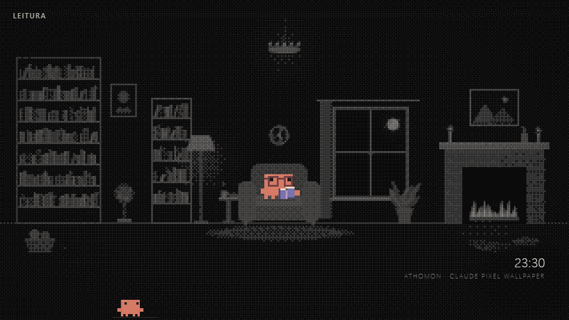

# Athomon — Claude Pixel Wallpaper

A quiet animated wallpaper for Windows: 11 pixel scenes, a tiny Claude companion in the transparent taskbar, and Claude FM playing inside the scenery.

Independent fan project by [MuriloDPV](https://github.com/MuriloDPV), inspired by Clawd and the atmosphere of Claude FM. Not affiliated with Anthropic.



**[Português brasileiro](README.pt-BR.md)** · **[Download / Releases](https://github.com/MuriloDPV/athomon-claude-wallpaper/releases)**

## Install with Lively Wallpaper

1. Install [Lively Wallpaper](https://github.com/rocksdanister/lively).
2. Download `athomon-claude-wallpaper-v1.0.0-lively.zip` from Releases.
3. Drag the ZIP directly into Lively. You do not need to extract it.

You can also download [`index.html`](index.html), keep it in a permanent folder, and add that file to Lively. No build, Node.js, account, or API key is required. Open the HTML in Edge or Chrome to preview it.

## What's inside

- Eleven rotating scenes: atom, office, café, reading room, servers, studio, campsite, observatory, greenhouse, workshop, and train station.
- Pixel characters with scene-specific activities and props.
- A small taskbar companion that waves, types, sips coffee, reads, and listens to music.
- Dark and light themes, a clock, and a date.
- Claude FM through the YouTube player, positioned inside each scene.

Scenes change every 150 seconds. The atom scene has no character in its center; the taskbar companion remains available.

## Taskbar companion

The companion is part of the wallpaper. To see it through the Windows taskbar, enable a transparent taskbar, for example with [TranslucentTB](https://github.com/TranslucentTB/TranslucentTB). It fits the default 48 CSS-pixel taskbar strip and starts 220 CSS pixels from the left edge.

If Lively pauses the wallpaper when an application fills the screen, the companion also pauses. Adjust Lively's [Performance settings](https://github.com/rocksdanister/lively/wiki/Performance) if you want it to keep moving. Move the companion using `CONFIG.claudeNaBarra.x` if your taskbar icons occupy that position.

## Customize

Edit the `CONFIG` object near the start of the main script in `index.html`:

| Setting | Default | Purpose |
| --- | --- | --- |
| `tema` | `"escuro"` | Use `"claro"` for the light theme |
| `cenaFixa` | `""` | Set a scene name to stop rotation |
| `trocaCenaSeg` | `150` | Seconds per scene |
| `fps` | `24` | Animation frame limit |
| `margemBarra` | `48` | Taskbar height in CSS pixels; `0` hides the companion |
| `claudeNaBarra.ativo` | `true` | Show the taskbar companion |
| `claudeNaBarra.x` | `220` | Companion position from the left edge |
| `claudeNaBarra.tamanho` | `2` | Companion pixel scale |
| `claudeFM.ativo` | `true` | Enable the external YouTube player |
| `claudeFM.volume` | `35` | Player volume, from 0 to 100 |
| `claudeFM.link` | Claude FM stream | Replace the public YouTube link if the stream changes |

Scene names: `athomon`, `escritorio`, `cafe`, `leitura`, `servidores`, `estudio`, `acampamento`, `observatorio`, `estufa`, `oficina`, `estacao`.

Browser preview examples:

```text
index.html?cena=leitura&fm=0
index.html?cena=estufa&tema=claro&fm=0
```

With Claude FM enabled, the wallpaper loads YouTube and requires internet access. YouTube playback depends on stream availability, embedding permissions, and the browser's autoplay policy. If sound is blocked, click the wallpaper once. With `claudeFM.ativo: false` or `?fm=0`, the wallpaper runs locally without external requests. The public edition has no service monitor, news feed, analytics, or private endpoints.

## Project files

`index.html` contains all scene and mascot code. `LivelyInfo.json`, `thumbnail.jpg`, and `preview.gif` provide Lively library metadata and previews. The HTML does not depend on those preview files to run.

## Credits and license

Code is provided under the [MIT license](LICENSE). Third-party names, character references, and streamed media are described in [CREDITS.md](CREDITS.md); the code license does not grant rights to those elements. Claude FM is embedded from YouTube, not bundled or redistributed as a video/audio file.
