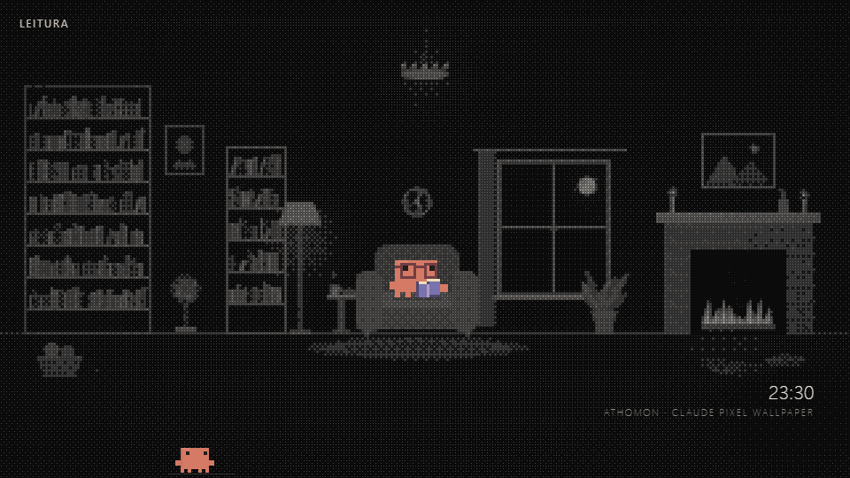

# Athomon — Claude Pixel Wallpaper

Wallpaper animado para Windows com 11 cenários em pixel art, um mini-Claude na barra de tarefas transparente e Claude FM integrado aos ambientes.

Projeto independente de fã por [MuriloDPV](https://github.com/MuriloDPV), inspirado no Clawd e no clima do Claude FM. Sem vínculo com a Anthropic.



## Instalar

1. Instale o [Lively Wallpaper](https://github.com/rocksdanister/lively).
2. Baixe `athomon-claude-wallpaper-v1.1.0-lively.zip` na seção [Releases](https://github.com/MuriloDPV/athomon-claude-wallpaper/releases).
3. Arraste o ZIP diretamente para o Lively, sem extrair.

Também é possível baixar o [`index.html`](index.html), salvá-lo em uma pasta permanente e adicionar esse arquivo ao Lively. Não precisa compilar, instalar Node.js, ter conta ou chave de API. Para experimentar, abra o HTML no Edge ou Chrome.

O ZIP escolhe automaticamente inglês ou português brasileiro. A Release também inclui `athomon-wallpaper-en.html` e `athomon-wallpaper-pt-BR.html` para quem prefere um arquivo avulso com idioma fixo.

## Cenários e animações

São 11 cenários: átomo, escritório, café, leitura, servidores, estúdio, acampamento, observatório, estufa, oficina e estação. Cada ambiente tem suas próprias ações e objetos. A troca acontece a cada 150 segundos.

O mini-Claude da barra alterna entre acenar, digitar, tomar café, ler e ouvir música. O cenário do átomo continua sem mascote no centro.

O wallpaper tem inglês e português brasileiro, escolhidos automaticamente pelo idioma do navegador. As placas, os nomes dos ambientes e a data também são traduzidos. Você pode fixar o idioma com `idioma: "en"` ou `idioma: "pt-BR"` na configuração, ou usar `?lang=en` / `?lang=pt-BR` no endereço.

## Mini-Claude na barra

Ele faz parte do wallpaper e aparece através da barra de tarefas transparente. Você pode usar o [TranslucentTB](https://github.com/TranslucentTB/TranslucentTB) para obter esse efeito. A faixa padrão tem 48 pixels CSS de altura; a posição inicial é 220 pixels CSS a partir da esquerda.

Se o Lively pausar a reprodução quando um aplicativo ocupar a tela, o mini-Claude também vai parar. Ajuste as opções de [Desempenho do Lively](https://github.com/rocksdanister/lively/wiki/Performance) para continuar animando. Se houver ícones nessa posição, altere `CONFIG.claudeNaBarra.x`.

## Personalizar

Abra o `index.html` em um editor de texto e procure `const CONFIG`.

| Opção | Padrão | Função |
| --- | --- | --- |
| `idioma` | `"auto"` | Idioma: `"auto"`, `"en"` ou `"pt-BR"` |
| `tema` | `"escuro"` | Use `"claro"` para o tema claro |
| `cenaFixa` | `""` | Nome do cenário para interromper a rotação |
| `trocaCenaSeg` | `150` | Segundos em cada cenário |
| `fps` | `24` | Limite de quadros por segundo |
| `margemBarra` | `48` | Altura da barra em pixels CSS; `0` esconde o mini-Claude |
| `claudeNaBarra.ativo` | `true` | Mostrar o mini-Claude |
| `claudeNaBarra.x` | `220` | Posição horizontal do mini-Claude |
| `claudeNaBarra.tamanho` | `2` | Escala dos pixels do mini-Claude |
| `claudeFM.ativo` | `true` | Ativar o player externo do YouTube |
| `claudeFM.volume` | `35` | Volume de 0 a 100 |
| `claudeFM.link` | Live do Claude FM | Link público do YouTube; pode ser atualizado se a live mudar |

Nomes dos cenários: `athomon`, `escritorio`, `cafe`, `leitura`, `servidores`, `estudio`, `acampamento`, `observatorio`, `estufa`, `oficina`, `estacao`.

Para testar no navegador:

```text
index.html?cena=leitura&lang=en
index.html?cena=estufa&tema=claro&lang=pt-BR&fm=0
```

O Claude FM usa o player do YouTube e precisa de internet. A reprodução depende da disponibilidade da live, da permissão para incorporação e das regras de reprodução automática do navegador. Se o som estiver bloqueado, clique uma vez no wallpaper. Com `claudeFM.ativo: false` ou `?fm=0`, o wallpaper funciona localmente sem conexões externas. A edição pública não tem monitoramento de serviços, notícias, analytics nem endereços privados.

## Créditos e licença

O código está sob a [licença MIT](LICENSE). Consulte [CREDITS.md](CREDITS.md) para os nomes, referências de personagem e mídia de terceiros, que não são licenciados por este projeto. O vídeo e a música do Claude FM são incorporados pelo YouTube, sem cópias no pacote.
